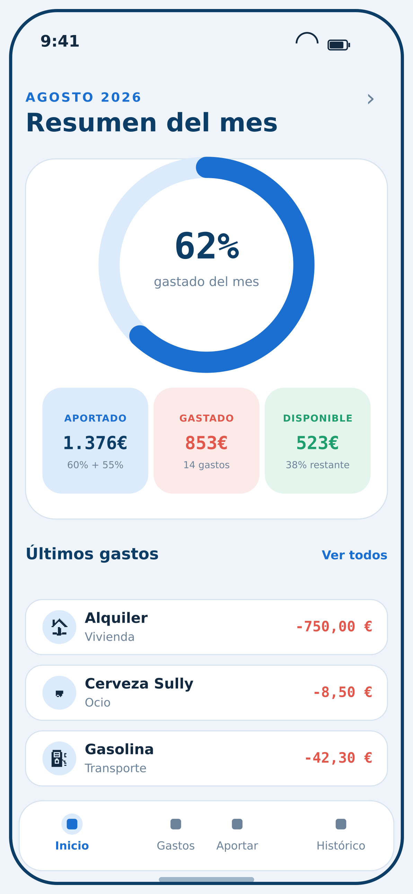
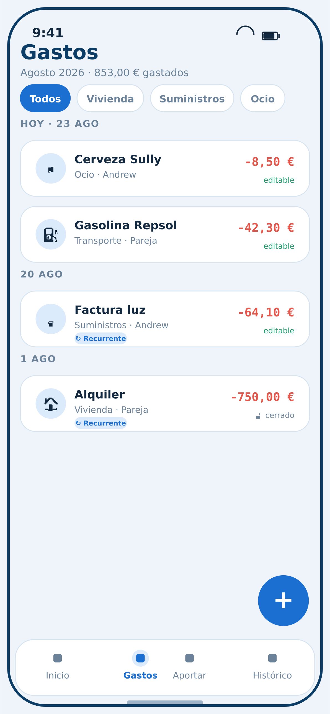
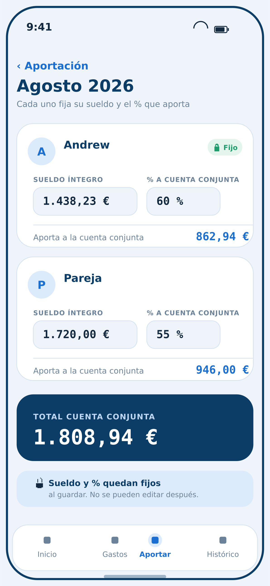

<p align="center">
  <a href="https://github.com/andrwdnc/not_problems_app/actions/workflows/ci.yml"></a>
  <a href="LICENSE"></a>
  
  
</p>

# Nest — Tu espacio financiero compartido

Aplicación web mobile-first para que **dos personas gestionen su dinero compartido**:
sueldos, un porcentaje de aportación a una cuenta común, gastos comunes y el
balance del mes (aportado / gastado / disponible). Incluye también un área
privada por persona para el gasto individual.

> **Estado:** en pruebas. La cuenta conjunta está estable y en uso diario; el área
> individual está completa pero solo la ha usado el autor.

<p align="center">
  
  
  
</p>

---

## Qué hace

Dos personas comparten un hogar. El dinero entra por dos sueldos y sale por un
presupuesto mensual. La app responde a las preguntas que surgen a fin de mes:

- ¿Cuánto ha aportado cada uno a la cuenta común?
- ¿Cuánto se ha gastado y cuánto queda?
- ¿Cuánto se puede gastar aún este mes?
- ¿Qué ha gastado cada uno por su cuenta, sin tener que preguntar?

| | Cuenta conjunta | Área individual |
|---|---|---|
| Sueldos | De los dos, desde un solo formulario | Solo el tuyo |
| Porcentaje | Un valor único para el mes, aplicado a los dos | Se muestra como `100 − compartido` |
| Presupuesto | Un tope compartido | Tu propio tope, por persona |
| Gastos | Comunes, visibles para los dos | Privados, solo tuyos |
| Histórico | Meses cerrados, editable en ventana de gracia | Tu propio histórico |

Ambas áreas comparten el mismo mes, los mismos sueldos y la misma navegación. Solo
cambia el prefijo de la URL (`/conjunta/...` o `/individual/...`) y qué datos ves.

---

## Cómo se usa

1. **Entrar** con tu usuario (la app admite como máximo dos cuentas).
2. **Elegir área**: cuenta conjunta o área individual, desde el enlace "Cambiar de
   cuenta" de la cabecera.
3. **Fijar el mes**: en *Aportar* introduce tu sueldo íntegro y el porcentaje
   compartido del mes. Una vez guardados, quedan bloqueados (🔒).
4. **Fijar el presupuesto** mensual (tope de gasto) si quieres el anillo de
   progreso.
5. **Registrar gastos** del día a día en *Gastos*: categoría, detalle, importe y
   fecha. La fecha decide a qué mes afecta el gasto, no el día en que lo registras.
   - Marca un gasto como **recurrente** y se duplicará automáticamente al mes
     siguiente.
6. **Pagos previstos**: apunta los pagos que se repiten cada año (seguro del
   coche, impuesto de circulación…) con su mes, día e importe de referencia. Cuando
   llega su mes aparecen en la pantalla de Gastos con un botón "Registrar gasto"
   que precarga el formulario; tú ajustas el importe real y guardas. No descuentan
   del mes por sí solos.
7. **Consultar el Inicio**: anillo de progreso + tarjetas Aportado / Gastado /
   Disponible.
8. **Histórico**: meses cerrados con su balance. El mes actual es totalmente
   editable; el mes anterior lo es hasta el día 5 inclusive (después solo admite
   altas nuevas); lo más antiguo es solo lectura.

---

## Puesta en marcha (desarrollo)

Requisitos: **Node.js 24.x** y una base de datos **PostgreSQL** (Supabase).

```bash
git clone https://github.com/andrwdnc/not_problems_app.git
cd not_problems_app
npm install

cp .env.example .env.local    # rellena DATABASE_URL, DIRECT_URL, AUTH_SECRET
npm run db:push               # aplica el esquema
npm run db:migrate:pagos-previstos   # tabla de pagos previstos
npm run db:migrate:auth-seguridad     # rate limit + trigger de máximo 2 usuarios
npm run dev                   # http://localhost:3000
```

Genera el secreto de sesión con:

```bash
openssl rand -base64 48
```

Comandos útiles:

| Comando | Para qué sirve |
|---|---|
| `npm run dev` | Servidor de desarrollo |
| `npm run build` | Build de producción |
| `npm run lint` | ESLint |
| `npm run typecheck` | `tsc --noEmit` |
| `npm test` | Tests unitarios (Vitest) |
| `npm run db:studio` | Drizzle Studio |

---

## Stack

Next.js 14 (App Router) · TypeScript (strict) · Supabase (PostgreSQL) · Drizzle ORM ·
Tailwind CSS v4 · Zod · Vitest. Dinero guardado en céntimos enteros (`bigint`), nunca
como coma flotante.

---

## Documentación

| Archivo | Contenido |
|---|---|
| [`docs/spec.md`](docs/spec.md) | Especificación funcional: modelo de datos, reglas, diseño de pantallas |
| [`docs/security.md`](docs/security.md) | Postura de seguridad y deuda aceptada |
| [`AGENTS.md`](AGENTS.md) | Guía de desarrollo: arquitectura, SOLID, invariantes, comandos |
| [`CONTRIBUTING.md`](CONTRIBUTING.md) | Setup, convenciones de commit, checklist de revisión |

---

## Licencia

MIT — ver [LICENSE](LICENSE).